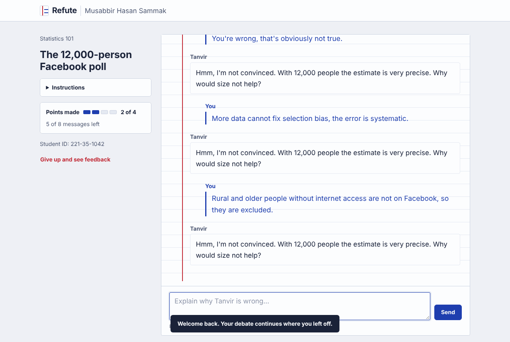
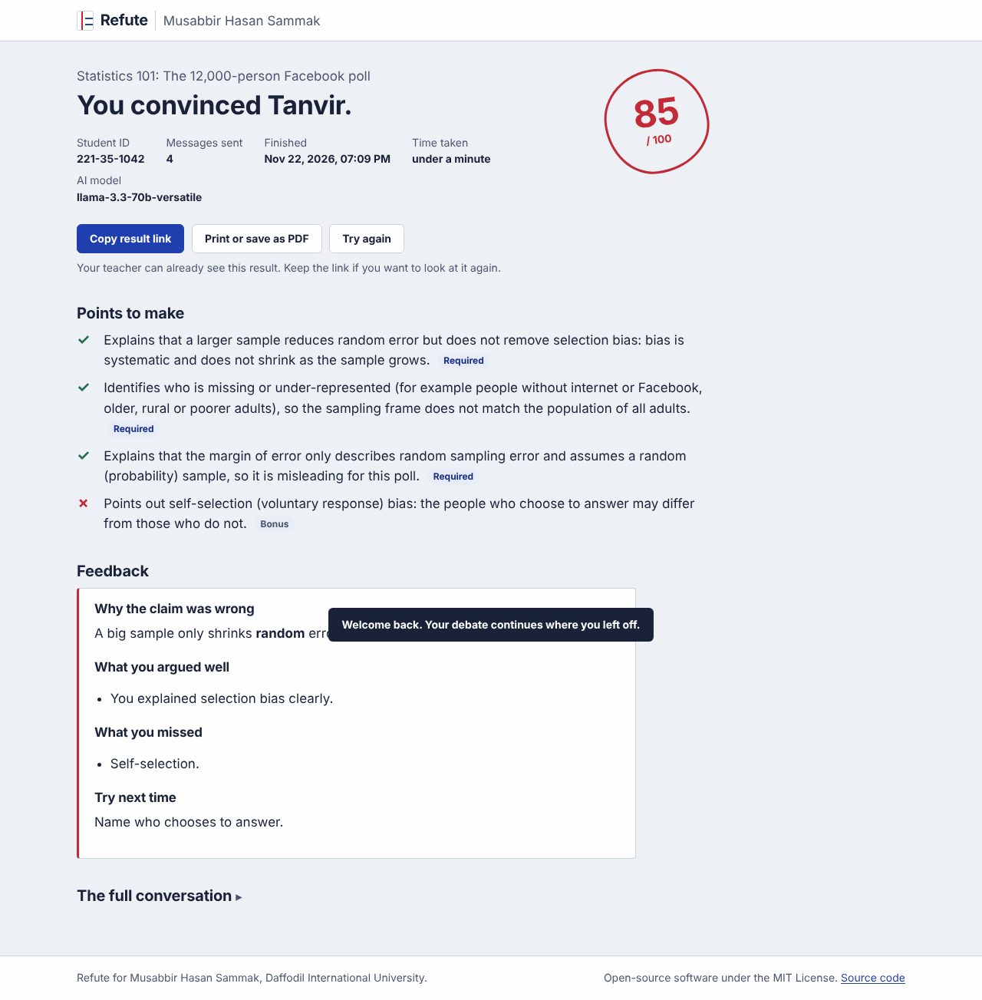

# Refute

**Students learn by arguing an AI out of its mistakes.**

You write a flawed claim, such as "a huge online poll represents the whole country", the character who believes it, and the points a student must make to refute it. You share a link. Each student enters their student ID and email, and the AI defends the claim politely and stubbornly. After every message a hidden judge checks which points the student has properly explained, and the AI gives in only when every required point has been made. Students get a score and feedback. You see every argument and which concepts the class keeps missing.

Refute is free, open-source software for individual teachers. You run your own copy, on your own free Supabase project, with your own AI key. Students don't need accounts, and they never see your key, the points to make or the correct answer.



| Your dashboard | A student's result |
|---|---|
|  |  |

## Features

**For you, the teacher**
- Courses, with any number of debate tasks in each
- Five ready-made scenarios (sampling bias, misreading p-values, correlation vs causation, survivorship bias, the gambler's fallacy), or write your own for any subject
- Your AI provider, model and key, set once in Settings, used by every student, so everyone argues with the same AI
- Control how stubborn the AI is, the conversation language (English, Bangla or the student's language), the message limit, retries, and whether students see the points afterwards
- An optional class list per course: only those student IDs can join
- A switch on every task link: turn it off when the class is done
- A preview that shows what the hidden judge decides after each message
- A class summary, which points students made or missed, every conversation, and a CSV download

**For students**
- Open the link, type a student ID and email, and argue: no account, no key, no setup
- Progress is saved after every message. Closed the page? Open the link again and enter the same ID to continue
- A scored result with written feedback

---

## How it works

```
Student's browser ──► refute-ai server function ──► Google Gemini or Groq
        │                    │  (your key, your prompts,
        │                    │   judging and scoring)
        └──────────────► Supabase database ◄──┘
```

- The website is static files: host it anywhere for free.
- **Supabase** stores your courses, tasks and results, and signs you in. Students don't sign in.
- **The `refute-ai` server function** (a Supabase Edge Function) runs every debate turn: it builds the prompts, calls the AI with your key, judges the student's points, scores the result and saves it. Your key, the points and the correct explanation never leave the server.

## Setting up your copy

You need [Node.js](https://nodejs.org) 18.17 or newer, a free [Supabase](https://supabase.com) account, and a free API key from [Google AI Studio](https://aistudio.google.com/apikey) or [GroqCloud](https://console.groq.com/keys). It takes about 20 minutes. Refute has no npm dependencies.

### 1. Create the database

1. Create a project at [supabase.com](https://supabase.com). Pick the region closest to your students.
2. Open **SQL Editor → New query**, paste the contents of `supabase/migrations/20261122000000_initial_schema.sql`, and press **Run**. It's safe to run again.

### 2. Deploy the AI function

In the Supabase dashboard:

1. Open **Edge Functions → Deploy a new function → Via editor**.
2. Name it exactly `refute-ai`.
3. Replace the example code with the contents of `supabase/functions/refute-ai/index.ts`, and press **Deploy**.
4. Open the function's settings and switch off **Enforce JWT verification** (sometimes called "Verify JWT"), then save. The function checks access itself; students don't have accounts, so this check must be off.

With the [Supabase CLI](https://supabase.com/docs/guides/cli) you can instead run:

```bash
supabase link
supabase db push
supabase functions deploy refute-ai --no-verify-jwt
```

If the app later says the server is "missing its Supabase settings", open **Edge Functions → Secrets** and add a secret named `REFUTE_SERVICE_KEY` holding your project's secret key (Project Settings → API Keys).

### 3. Configure and put the website online

Copy `.env.example` to `.env` and fill in:

| Variable | Required | What it is |
|---|---|---|
| `SUPABASE_URL` | Yes | Project Settings → Data API → Project URL |
| `SUPABASE_PUBLISHABLE_KEY` | Yes | Project Settings → API Keys → publishable key (`sb_publishable_...`). Older projects can set `SUPABASE_ANON_KEY`. Never a secret key: the build refuses it. |
| `REFUTE_APP_NAME` | No | Rename the app. Default `Refute`. |
| `REFUTE_SOURCE_URL` | No | Link to the source code you run, in the footer. |

Then deploy. `npm run build` writes the site to `dist/`, and ready-made configurations are included:

- **Vercel:** import the repository, add the variables above, and deploy. `vercel.json` sets the build.
- **Netlify:** import the repository and add the variables. `netlify.toml` sets the build.
- **GitHub Pages:** Settings → Pages → Source: GitHub Actions, then add the variables under Settings → Secrets and variables → Actions → Variables. The workflow in `.github/workflows/deploy-pages.yml` publishes on every push to `main`.
- **Docker:** `cp .env.example .env`, fill it in, then `docker compose up -d`. Put HTTPS in front of it.
- **On your own computer:** `npm run dev`, then open http://127.0.0.1:8000.

### 4. Tell Supabase your site's address

In Supabase, open **Authentication → URL Configuration**. Set **Site URL** to your site's address and add it to **Redirect URLs**.

### 5. Create your teacher account

Open your site and press **Set up Refute**. The first account created becomes the teacher; any account made after it gets no access.

Supabase sends a confirmation email. Its built-in email service only delivers to the people on your Supabase account, so either sign up with the same email as your Supabase account, or switch off **Confirm email** first (Authentication → Sign In / Providers → Email). Once your account exists, you can also switch off **Allow new users to sign up** there.

### 6. Set your AI key and model

Open **Settings**, choose Google Gemini or Groq, paste your key, press **Load models**, pick a model and press **Save AI settings**. Refute checks that the key and model work before saving. The key is stored on the server: even you can't read it back from the website, only replace it.

## Running a class

1. **Courses → New course.** Optionally paste your students' IDs into the course's **class list**.
2. **New task.** Start from a scenario, edit it, and press **Create and try it** to argue with it once yourself.
3. **Copy the student link** from the task page and share it in class.
4. Watch results arrive on the task page. Press **View** to read a conversation, or **Download CSV** for grading.
5. **Switch the link off** when the class is done.

## Protecting your AI key

Every student uses your key, so its free limits are shared by the whole class. Refute limits how it can be used:

- The key never leaves the server, so nobody can copy it.
- The server function only runs debate turns for real attempts on open tasks. It can't be used as a general chatbot.
- Each attempt is capped at the task's message limit, and each message at 2,000 characters.
- With a **class list**, made-up student IDs are refused.
- When a task's **link is switched off**, nobody can start or continue it.

Each student message uses two AI requests (the judge and the reply), plus one for the feedback at the end. Check your provider's per-minute and per-day limits; for a whole class at once, a paid key may be needed.

## What students can and can't see

- Students see the task's instructions, the character and the conversation. The points to make appear only after the debate, and only if you allow it. The correct explanation is never shown, except in the feedback.
- Scores are calculated on the server, so they can't be faked from the browser.
- There are no student accounts. Anyone who types a student's ID can continue that student's unfinished debate, and the result link works for anyone who has it. This is meant for class use, where you can see who is doing what.

## Limits of the free services

- **Supabase free plan:** about 500 MB of database (tens of thousands of debates). A free project pauses after a week without activity. The data is kept, and you resume it from the dashboard. Check [supabase.com/pricing](https://supabase.com/pricing) for current numbers.
- **Free AI keys:** limited requests per minute and per day, shared by your students. When a limit is hit, the student sees a message and presses Retry; nothing is lost.

## Customising

| What | Where |
|---|---|
| Ready-made scenarios | `js/templates.js` |
| How the AI argues, judges and writes feedback | the prompts in `supabase/functions/refute-ai/index.ts` (redeploy the function after changing them) |
| Colours and fonts | the variables at the top of `css/style.css` |

## Project structure

```
index.html                        page shell
css/style.css                     all styling
js/app.js                         routing and sign-in
js/session.js                     who is signed in; the site's name
js/db.js                          all database calls
js/ai.js                          calls to the refute-ai server function
js/views/                         screens
js/templates.js                   ready-made scenarios
supabase/migrations/              database schema, security rules, public functions
supabase/functions/refute-ai/     the server function that runs debates
supabase/tests/                   database security tests
scripts/                          config generator, build and local server
tests/unit/                       server function and config tests (npm test)
tests/e2e/                        browser test with a fake Supabase and a fake AI
```

## Contributing

Contributions are welcome, especially new scenarios, translations and accessibility improvements. See [CONTRIBUTING.md](CONTRIBUTING.md). To report a security problem, see [SECURITY.md](SECURITY.md).

## License

[MIT](LICENSE) © 2026 Musabbir Hasan Sammak
